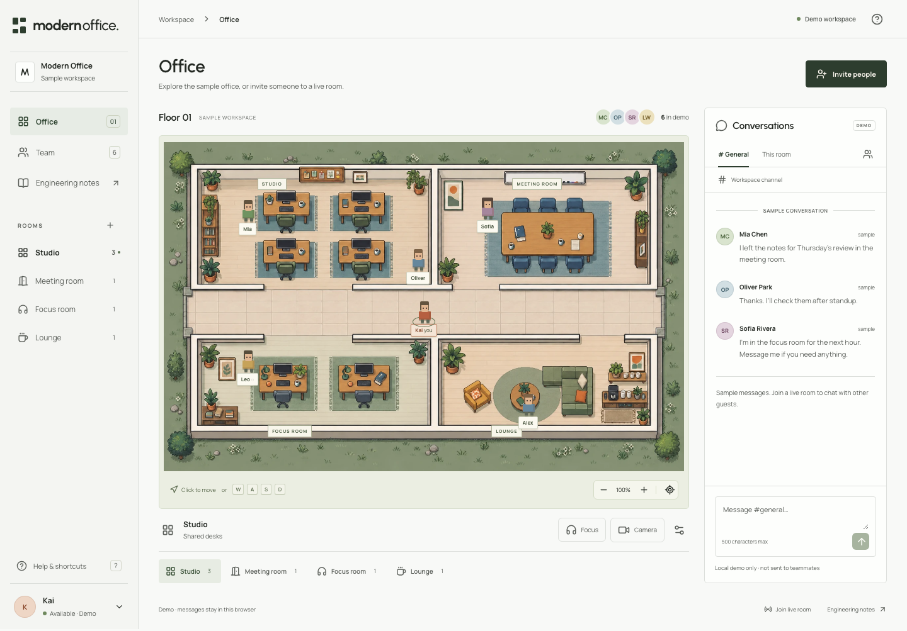

# Modern Office

**Spatial collaboration.** 空間型遠端協作作品：互動辦公室、即時聊天、一對一 WebRTC 視訊。




> Vue 原型的重新設計／重構版。原始 `modern-office-main` 資料夾未修改。設計與程式由 AI 協助；素材來源與工程限制均有說明。

## 技術與零成本策略

- **Next.js 16.4 + React 19.3 + TypeScript**：App Router，靜態輸出，不需要前端常駐 Node server。
- **Bun**：套件管理、原生 WebSocket server、單元測試。
- **Zod**：雙向訊息驗證；server 掌握身份與資料邊界。
- **Cloudflare Workers + SQLite Durable Objects**：同源靜態託管與可休眠 WebSocket，公開真人 presence/chat。
- **Native WebRTC**：明確同意的一對一通話；可選自架 TURN。
- **CSS + 本機 WebP／字型**：不依賴付費素材服務、圖片 API、字型 CDN。
- **Playwright + axe-core**：核心流程、多訪客與自動可及性測試。

本機無雲端帳號即可執行所有功能。公開部署使用 Cloudflare Workers Free，不新增付費訂閱／信用卡／商業 API；需要 Cloudflare 免費帳號與部署登入。免費配額有限，已有 Paid 帳號不能保證新增服務零費用，跨 NAT 視訊可能另需 TURN。詳見部署文件。

## 公開體驗

[Modern Office](https://modern-office.traceai-api.workers.dev/) — 免註冊真人 workspace。開 Invite people → Open a second guest，即可自行測試雙連線。

## 本機啟動

需要 Bun 1.4+ 和 Node.js 24（與 CI 一致）。Next CLI 使用 Node；Bun 負責安裝、測試與 realtime runtime。

```bash
bun install --frozen-lockfile
bun dev
```

打開 **http://127.0.0.1:3100**。前端使用 3100、realtime 使用 3101，避免佔用常見的 3000。

不用設定環境變數就能在本機展示與連線。`.env.example` 是可選設定；若調整 realtime，將檔案複製成 `.env.local`，也要為 Bun server 的環境明確配置（例如 shell 環境或 Bun `--env-file`）。

### 真人互動

1. 按 **Connect live**。
2. 用 **Invite people** 複製 workspace link，在另一個瀏覽器視窗（公開版可跨電腦）開啟。
3. 修改不同名字；走動與傳訊會同步。
4. 點訪客 → **Start a video call**，另一端按 **Accept call**。
5. 測試需要裝置權限；CI 使用假攝影機，沒有擷取你的真實攝影機。

展示模式的名字與聊天僅在記憶體存在，刷新後重置。Live history 在最後一位客人離線後清空。客人 link 不是驗證身份的憑證。

## 公開部署

```bash
NEXT_PUBLIC_SITE_URL=https://modern-office.YOUR-SUBDOMAIN.workers.dev bun run deploy
```

部署前確認帳號 Workers Free。公開版預設 live，分享 workspace link 進同一間房；邀請視窗 **Open a second guest** 可讓面試官自行測雙連線。`?mode=demo` 可切回樣本。

## 驗證

```bash
bun run lint
bun run typecheck
bun run test
bunx playwright install chromium
bun run test:e2e
bun run build
```

`bun test` 和 `bun run test` 均只執行 `tests/unit`（由 `bunfig.toml` 設定）。完整品質檢查可執行 `bun run check`；E2E 另跑。

```bash
bun run build
bun start          # 以 Bun 靜態伺服器預覽 out/，不是 next start
```

## 結構

```text
src/app/           靜態外殼、作品案例頁、全域 tokens
src/components/    地圖、聊天、導航、原生 dialogs、視訊
src/hooks/         office transport / WebRTC 生命週期
src/lib/           共用協定、geometry、明確標記的 demo fixtures
server/            Bun / Cloudflare realtime / shared room domain / static preview
tests/             單元、Playwright、多訪客、axe-core
 docs/             架構、免費部署、面試解說、素材來源
```

## 功能邊界

- 四個房間，鍵盤移動／合法地點點擊定位／房間快捷入口。
- 全域／房間公開聊天室；沒有私人 DM、錄影、群組會議。
- Room capacity 是資訊，不是預約限制。
- 本機 in-memory；雲端單一可休眠 coordinator，最多 32 位／workspace、256 guests 全域、100 則 recent messages。不是無限水平擴展架構。
- WebRTC 使用免費公共 STUN；困難的 NAT 可能需要自行部署 TURN，並產生主機／流量成本。

閱讀 [Architecture](docs/ARCHITECTURE.md)、[零成本部署](docs/DEPLOYMENT.md)、[面試展示指南](docs/INTERVIEW.md)、[素材來源](docs/ASSETS.md)。
